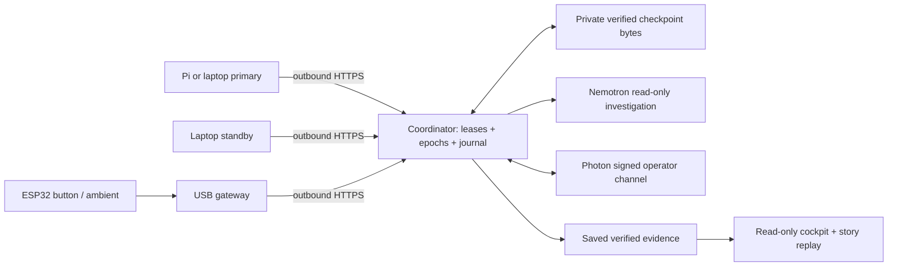

# LIFERAFT

**Your training job never finds out the machine was dying.**

Missed warnings and unclear handoffs turn a failed machine into a lost night of
training. LIFERAFT watches risk, prepares a software evacuation, resumes a
checkpoint-aware job on a standby, proves continuity, and briefs the on-call
engineer. The coordinator ledger is infrastructure; the product is **predict,
decide, evacuate, prove, brief**.

[Live Raspberry Pi demo and previous-job verification](docs/LIVE_HARDWARE_DEMO.md)

## Mission Control dashboard (single page)

`npm run dev` then open http://127.0.0.1:3000. One page tells the whole story in
plain English: a fleet map with a "baton" showing which machine owns the job,
a six-step narrative, early-warning and loss charts, "why not just a database"
guardrails, the read-only AI ops agent, the on-call channel, a shift handoff
brief and a cost model. **Replay** (works offline) plays four real drills
(overheating, crash, corrupted save, zombie primary). **Live hardware** polls the
hosted coordinator and can start the Pi job. Toggle **Show technical details** for the
hash-chained flight recorder. The previous console is at `/evidence`; `/story`
and `/live` redirect to `/`.

## Run the MVP presentation

### Pi + Windows training logs

Both `/story` and `/` include **Training activity**, with separate Raspberry Pi
and Windows panes. The feed refreshes three seconds after each completed read,
shows recent/stale/finished/saved states, and supports pause and manual refresh.
Newest entries appear first; all timestamps are UTC. This feed is independent
of the saved-replay cursor and cannot control recovery.

The dashboard discovers the job from a running local `liferaft cloud ... worker`
command, automatically captured worker sessions, or the latest verified saved
export. You do not need to look up a job ID for normal operation. Worker runs
started with the updated code automatically mirror their redacted structured
output into ignored `.liferaft/worker-logs/`. Local logs include each real
optimizer step/loss; remote coordinator activity includes heartbeats (~2s),
checkpoint commits, Pi CPU readings and handoff events, not arbitrary terminal
stdout. No physical device is inferred from local rehearsal worker IDs.

**One private setup step for the remote Pi feed:** the dashboard computer needs
the coordinator operator credential to read events for both devices. The ignored
`.env.operator` has been prepared with the coordinator origin and an empty token.

1. Open **Render dashboard → liferaft-coordinator → Environment**. Find the
   existing `LIFERAFT_OPERATOR_TOKEN`. Use that value; do not create a replacement
   or change the running coordinator's configuration.
2. On the dashboard computer, open `.env.operator` in your editor. Paste the
   value after `LIFERAFT_CLOUD_TOKEN=` and save. Keep the existing URL. Never put
   the token in chat, Git, screenshots, browser code, the Pi profile, or firmware.
   The operator credential is held only by the local backend; this feed exposes
   no mutation route and never uses it for an action other than event reads.
3. Start the workers with their existing shared-job commands and their own Pi /
   standby profiles. Runs using the updated code record session metadata and
   terminal logs automatically. The running dashboard rereads its operator file
   each poll; no dashboard restart or job-ID entry is required.
4. Verify **LIVE COORDINATOR**, the auto-selected job and timestamped Pi / Windows
   rows. A connected reader does not imply an active worker: old timestamps are
   marked stale. If no local worker runs, an optional backend-only
   `LIFERAFT_LOG_JOB` can select a known job; otherwise run the Windows standby
   so its job can be discovered.

If access is denied or the network fails, local/saved logs remain available and
the panel explains the failure. With no readings, the Pi remains **Waiting for
logs**. It is never substituted with the synthetic demo. The optional
`LIFERAFT_LOG_WINDOWS_WORKER` maps a nondefault Windows worker ID (default:
`laptop-standby`); platform metadata is displayed separately when reported.
Captured local files are untrusted diagnostic output and do not establish
checkpoint integrity or recovery proof. Coordinator event chains are verified
before their activity is displayed.

With the existing Python training environment and Node dependencies installed:

```powershell
npm run demo
```

This executes four genuine local CPU drills (about two minutes), then starts
[the story cockpit](http://127.0.0.1:3120/story). Press **Run the story** for an
explicit 90-second narrated replay with automatic panel focus. The browser is
read-only. Chaos buttons load observed drills rather than kill processes.
Use `npm run demo -- --reuse` to start quickly from the last saved evidence.
Stop the server with Ctrl+C. `LIFERAFT_DEMO_PORT` overrides port 3120.
No secrets, Pi, provider accounts or internet are needed after installation.

To generate only one fresh drill without starting the web server:

```powershell
.venv/Scripts/python.exe -m liferaft.rehearsal --scenario cooling
# Other choices: crash, corrupt, zombie. All four:
.venv/Scripts/python.exe -m liferaft.rehearsal --all
```

On macOS/Linux replace `.venv/Scripts/python.exe` with `.venv/bin/python`.
The new layer is additive; the original [evidence cockpit](http://127.0.0.1:3120/)
and coordinator/checkpoint verification are preserved. See
[the upgrade plan](docs/UPSCALE_PLAN.md) and [observed results](PHASE_TRACKER.md).

### A 60-second judge walkthrough

1. **0–10s:** “A dead machine is manageable. A job restarting from zero at 3am isn't.”
   Show the worker constellation and point out the local-rehearsal disclosure.
2. **10–20s:** Start the story or scrub to the eligible forecast. Explain the
   injected cooling trend and estimated thermal crossing; no real heating.
3. **20–35s:** Open a read-only tool result. Scrub to `LEASE_TRANSFERRED` and the
   next optimizer step: the deterministic coordinator yields, verifies and fences.
4. **35–45s:** Scrub to `verify_continuity`: show the real ghost overlay,
   `0.000000` divergence, matching weights and checkpoint hash prefix.
5. **45–60s:** Show the simulated on-call brief and ROLLBACK refusal. Select a
   corrupt-checkpoint or zombie replay to show the failure handling. Explain
   that live providers are a separate verified operating mode.

### Architecture



The rehearsal replaces hosted coordination/storage with the existing SQLite
and local-file adapters. It runs two real processes on **one computer**. It
does not establish a new cross-device result or migrate arbitrary processes.

### What is real versus simulated

| Capability | This MVP presentation |
|---|---|
| Training, checkpoint/resume | Real CPU PyTorch, optimizer and RNG state, actual second process |
| Ghost run | Fresh uninterrupted seed-1729 baseline; 100 losses and final model tensors compared exactly |
| Cooling prediction | Explainable estimator over injected readings; R² is trend fit, not failure probability |
| Crash / corruption / zombie | Real killed dedicated training process, disposable corrupted bytes rejected, stale epoch commit refused |
| Lease, fence, journal, hash check | Existing deterministic core; API rechecks chain and final checkpoint bytes |
| Pi / ambient telemetry | Not connected in rehearsal; existing physical collection is separate |
| Nemotron | Deterministic read-only fallback trace in story; existing live investigation available separately |
| Photon | Clearly simulated story transport and reply previews; existing live signed STATUS/ACK integration is separate |
| APPROVE / HOLD / ROLLBACK | Offline interaction previews, no mutation; live approval workflow deferred |
| Adaptive cadence / worker ranking | Recommendation and single fresh standby evidence; no invented health score or applied cadence claim |
| Cost avoided | Editable illustrative GPU estimate; unrelated to this measured CPU run |
| Network partition | Not included in this presentation matrix |

### Optional live provider and hardware mode

The presentation needs **no environment secrets**. To use the existing live
integrations, follow [the exact provider and Pi steps](docs/PHASES_3_8_OPERATOR_STEPS.md)
and [team setup](TEAM_SETUP_GUIDE.md). Do not paste keys or phone numbers in chat.

- **NVIDIA:** sign into NVIDIA Build, use its API-key screen, and privately set
  `NVIDIA_API_KEY` and a tool-capable `NVIDIA_MODEL_ID` in ignored `.env`.
  Run `liferaft investigate` on an exported incident as documented. Success is a
  provider trace with evidence-backed tool results. On failure use the clearly
  labeled deterministic rehearsal. A model never gains recovery authority.
- **Photon:** sign into [the dashboard](https://app.photon.codes), open the
  LIFERAFT project, provision an available channel only with team consent,
  and store the project key as `PHOTON_API_KEY` in ignored `.env.photon`.
  Use the project Messages view to obtain the consenting operator's direct
  space and user IDs. The guide's §6 lists exact Render webhook settings and
  runner variables (`LIFERAFT_CLOUD_URL`, scoped `LIFERAFT_CLOUD_TOKEN`,
  `PHOTON_PROJECT_ID`, `PHOTON_SPACE_ID`, `PHOTON_OPERATOR_USER_ID`,
  `PHOTON_AGENT_USER_ID`, `PHOTON_JOB`, `PHOTON_WEBHOOK_SECRET`, and enable flag).
  Verify a real `STATUS` reply, signed delivery callback and incident `ACK`;
  provider acceptance alone is not delivery. If provisioning fails, keep the
  mock transport. `HACKWITHPHOTON` promo eligibility is not verified.
- **Pi:** use the safety guide's official-power/cooling inspection before
  connecting hardware, then the existing read-only doctor and scoped worker
  instructions. Verify CPU telemetry separately from ambient. Leave relay and
  unknown fan disconnected. If PyTorch/ARM setup fails, retain laptop training
  and Pi telemetry-only mode; never heat the Pi to demonstrate a fault.

The current [Photon reference](https://photon.codes/docs/beta/api-reference)
was checked; the pasted hackathon Notion page was inaccessible. No new live
provider send, physical measurement or deployment is claimed by this upgrade.

For the next hosted, Pi, ESP32, Nemotron and Photon checks, see [the Phases 3–8 bring-up](docs/PHASES_3_8_OPERATOR_STEPS.md).

## Local setup

Use Python 3.11–3.13. Open Terminal (macOS/Linux) or PowerShell (Windows) in the project folder.

```sh
python3 -m venv .venv
.venv/bin/python -m pip install -r requirements-foundation.lock
.venv/bin/python -m pip install --no-deps -e .
.venv/bin/liferaft doctor --json --redact
.venv/bin/python -m unittest discover -s tests -p test_foundation.py -v
```

On Windows, use `py -3 -m venv .venv` and replace `.venv/bin/python` and `.venv/bin/liferaft` with `.venv\Scripts\python.exe` and `.venv\Scripts\liferaft.exe`. On a machine with the pinned packages already installed, use `python3 -m liferaft` without the editable install. Once installed, the local foundation runs offline.

Use `--network` on `doctor` to check outbound public HTTPS. Local operations have no peer network dependency. Serial device discovery only lists ports. It does not open ports or identify what is plugged in.

TypeScript contracts use Node 22 or later. Run `npm ci` and `npm exec -- tsc --strict --noEmit web/src/lib/contracts.ts`. Regenerate the wire-schema snapshot with `python3 -m liferaft.fixtures > contracts/v1.schema.json`.

For physical steps see [HARDWARE_SAFETY_AND_WIRING.md](HARDWARE_SAFETY_AND_WIRING.md). The relay and unverified fan stay disconnected.

## Train and resume locally

Install the training dependencies into your project environment. On Apple Silicon macOS:

```sh
.venv/bin/python -m pip install 'torch==2.15.0' 'numpy==2.4.1'
.venv/bin/python -m liferaft doctor --training --json --redact
```

On Linux or Windows, use the CPU-only PyTorch index for the Torch package. Pi-specific installability is verified separately in Phase 4.

```sh
python -m pip install --index-url https://download.pytorch.org/whl/cpu 'torch==2.15.0+cpu'
python -m pip install 'numpy==2.4.1'
```

From the project folder on this Mac:

```sh
.venv/bin/python -m liferaft train --steps 120 --checkpoint-every 10 --seed 1729
.venv/bin/python -m liferaft resume --checkpoint 'PASTE THE .pt PATH HERE' --steps 200 --seed 1729
.venv/bin/python -m unittest discover -s tests -v
```

Copy the `path` value from the final `CHECKPOINT_VERIFIED` line into the second command. Keep the `.json` manifest next to the `.pt` file. The resumed process should emit `TRAINING_STEP_COMPLETED` with `step_completed` 121. `--steps` sets the total target step. The logs give actual loss and checkpoint SHA-256. Only resume files produced by your own trusted LIFERAFT run. The local proof compares losses and final tensors exactly on one host. Cross-architecture evidence is tracked separately.

## Open the recovery cockpit

From the repo root, with the Python environment set up and the saved campus drill
at `.liferaft/campus-button-05.jsonl`, run:

```bash
npm ci
LIFERAFT_COCKPIT_JOB=campus-button-05 npm run dev
```

Open [the local cockpit](http://127.0.0.1:3000). The cockpit follows the [authoritative cockpit plan](docs/COCKPIT_PLAN.md).
Use the five dashboard cards, replay controls and detail dialogs to inspect
checkpoint, ownership, loss and event evidence. Re-verify reruns the Python verifier.
The Handoff Brief supports text/Markdown copy and paper-only printing.
The cockpit plan also covers operation, graphics fallback and QA commands.
See [hardware status](docs/HARDWARE_READINESS.md) for measured bench results
and remaining physical checks.

The console shows saved evidence and listens on loopback. The campus export has
one measured loss point. To see a full local curve, run the local failover demo
below, then point the cockpit at the run directory printed in its output:

```bash
LIFERAFT_COCKPIT_JOB=local-job LIFERAFT_COCKPIT_LOCAL_RUN=.liferaft/phase2-REPLACE_ME npm run dev
```

`LIFERAFT_COCKPIT_EVENTS` selects a journal at a different path.
`LIFERAFT_COCKPIT_INVESTIGATION` optionally points to a saved JSON line from
`liferaft investigate` for the same job and incident. The console validates its
tool evidence against the journal before showing it. On PowerShell, set each
variable with `$env:NAME = "value"` before running `npm run dev`.

`npm run typecheck`, `npm run test:contracts`, `npm test`, and `npm run build`
check the console. With a configured production server running, `npm run test:e2e`
runs browser checks. Use `npm start` after
building, with the same environment variables. A custom Python executable can
be selected using `LIFERAFT_COCKPIT_PYTHON`. Keep evidence files private and
serve the console locally.

## Run the local failover demo

From the project folder, run either scenario in the same environment that passed the training doctor check.

```sh
.venv/bin/python -m liferaft demo --scenario cooling-test
.venv/bin/python -m liferaft demo --scenario worker-crash
```

- **Cooling drill.** The command injects a simulated cooling incident in software. The primary saves a verified checkpoint and gives up its lease. The standby reads and rehashes the checkpoint, claims a new lease, and takes the next real training step.
- **Worker crash.** The command stops the dedicated primary training child process it launched. The standby waits for the primary's 12-second lease to expire, then continues from the last valid committed checkpoint. Recovery time in the report starts at detection, which occurs at lease expiry. Lost steps appear as `null` when the primary could not report its last step.

Success prints `LOCAL_RECOVERY_VERIFIED` with `owner: local-standby`, `epoch: 2` and `last_step: 70`. The output points to an `evidence.json` file under `.liferaft/phase2-*/`. The same directory holds each worker's loss log and the checkpoint artifacts. Both workers run on this computer, with no network or physical hardware required.

## Hosted recovery across two laptops

See the [Phase 3 Atlas and Render setup guide](docs/PHASE_3_ATLAS_SETUP.md) for the cloud deployment and recovery drill. Live verification status is in the phase tracker.

## Verify readiness and save a recovery brief

With the current coordinator revision deployed, the operator can check a job
without changing its lease or running recovery policy:

```sh
.venv/bin/python -m liferaft cloud --profile operator doctor --job campus-button-05
.venv/bin/python -m liferaft cloud --profile operator events --job campus-button-05 > .liferaft/campus-button-05.jsonl
.venv/bin/python -m liferaft evidence --job campus-button-05 --output .liferaft/campus-button-05-evidence.json
```

Substitute your actual job ID. On Windows use `.\.venv\Scripts\python.exe`.
The readiness result lists blocking reasons; a completed job correctly is not
ready for another drill. The events command captures all pages to a fixed hash
head and verifies them locally. `evidence` links checkpoint, ownership and measured
first-step records, keeps crash RPO unknown, and refuses to overwrite an existing
output. Saved legacy exports remain readable with `legacy_unanchored` completeness.
The brief is deterministic; Nemotron interpretation uses the separate command below.

See [software verification and remaining gates](docs/SOFTWARE_VERIFICATION.md)
for test commands, signed-transfer behavior, rolling compatibility and evidence limits.

## Investigate a rescue with NVIDIA Nemotron

Run the investigation from the dashboard station, Pranav's Mac. Ved's Windows laptop is the Raspberry Pi connection point. The investigator reads the job export, which identifies the workers that actually ran that job.

1. In the repo root on the Mac, add `NVIDIA_API_KEY=<your NVIDIA Build API key>` to the ignored `.env` file. `git check-ignore .env` should print `.env`. Keep the key in the local environment and out of Git and browser code. `NVIDIA_MODEL_ID` is optional and defaults to `nvidia/nemotron-3.5-lightning-30b-a3b`.
2. From the repo root, run the command below. If the file for this job is missing, run the preceding export command first. For a fresh drill, replace the job ID in both commands with the new ID.

   ```sh
   mkdir -p .liferaft
   .venv/bin/python -m liferaft cloud --profile operator events --job campus-button-05 > .liferaft/campus-button-05.jsonl
   .venv/bin/python -m liferaft investigate --job campus-button-05
   ```

Success prints `NEMOTRON_INVESTIGATION` with `source_type: provider`, a structured report, and the two tool results with event IDs. The `investigate` command verifies the export's hash chain, sends allowlisted incident fields to NVIDIA Build, and uses the resulting report as advisory output. If the provider fails, use the original coordinator export for the demo evidence. A failed request produces `NEMOTRON_INVESTIGATION_FAILED` with a redacted reason and exits 2.
